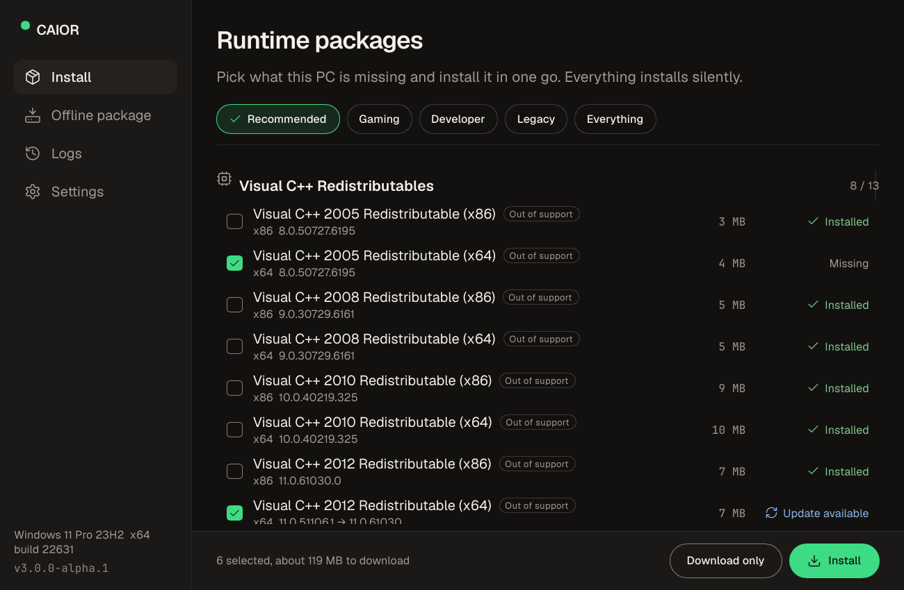

# CAIOR

Sets up the runtimes a fresh Windows needs, in one go: Visual C++ 2005 to v14, .NET Framework and .NET 6 to 10, DirectX, Java, WebView2, Windows App Runtime, WinGet, XNA, OpenAL, PhysX and more. Installs are silent, you approve administrator access once, and it works without internet too.



## Download

Get `caior.exe` from [Releases](../../releases). It is one file with nothing to install, for Windows 10 1809 or later and Windows 11 (x64).

The exe is not code-signed yet, so SmartScreen may warn the first time. Compare its SHA256 with the `caior.exe.sha256` file next to it.

## Use

Open `caior.exe`, pick a profile or single packages, then select **Install**. CAIOR checks what your PC already has, downloads only what is missing, verifies every file and installs it silently. Minimize the window and a small card in the bottom-right corner keeps showing progress.

For a PC without internet, open **Offline package**. CAIOR downloads and verifies the packages, then writes one `.exe` (or a folder) that installs them on any PC.

From a terminal:

```
caior install --profile recommended --silent
caior install --profile gaming --exclude vc-2005-* -y
caior pack --profile all --out D:\CAIOR-Offline.exe
caior detect
caior list
```

The exe is a window app, so `cmd` does not wait for it. In scripts, use `start /wait caior.exe ...`.

Exit codes: `0` done, `3010` done and Windows needs a restart, `1` something failed, `2` the command has a mistake, `1223` administrator approval declined. Logs are in `%ProgramData%\CAIOR\logs`, one folder per run.

## Safety

- Every file comes from its vendor: Microsoft, Eclipse Adoptium, NVIDIA, Creative, LunarG, python.org, nodejs.org. This project hosts no installers.
- A file must match its SHA256, or carry a valid signature from an allowed publisher. Signatures are checked offline, so offline packages are checked the same way.
- Each installer runs as a copy in a folder only administrators can change, checked again right before it starts.
- The administrator part takes only package ids and rebuilds the plan from the catalog inside the exe.

## Limits

- .NET Framework 3.5, DirectPlay and the Media Feature Pack come from Windows Update, so they need internet.
- An offline package holds the packages for the architecture of the PC that made it.

## Build

You need Windows and Rust 1.88 or later with the MSVC toolchain.

```
cargo build --release -p caior
cargo test --workspace
cargo xtask catalog check --strict
```

The UI tests run without a display, on Linux too: `cargo test -p caior-ui-tests`. Before a release, run `tools\test\check.ps1` and follow [docs/TEST-PLAN.md](docs/TEST-PLAN.md); real installs are tested in Windows Sandbox, see [tools/sandbox](tools/sandbox). The package catalog is in [catalog/](catalog), its format in [docs/CATALOG-FORMAT.md](docs/CATALOG-FORMAT.md).

## License

MIT, see [LICENSE](LICENSE). Each runtime keeps its vendor's license. Built with [Slint](https://slint.dev). Fonts: Geist and JetBrains Mono (OFL). Icons: Lucide (ISC).
