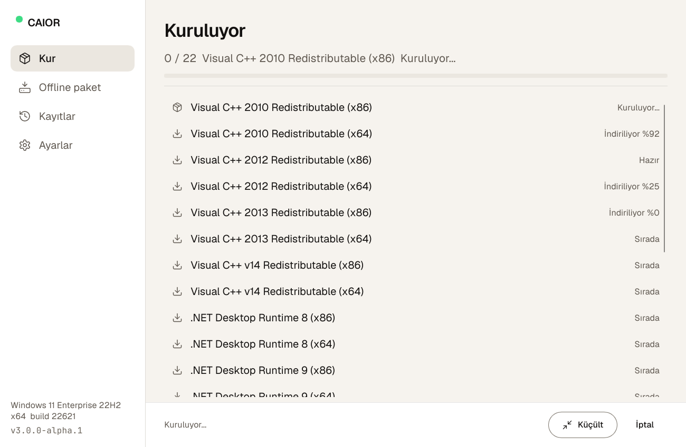
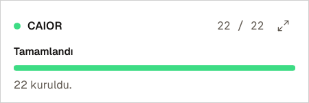
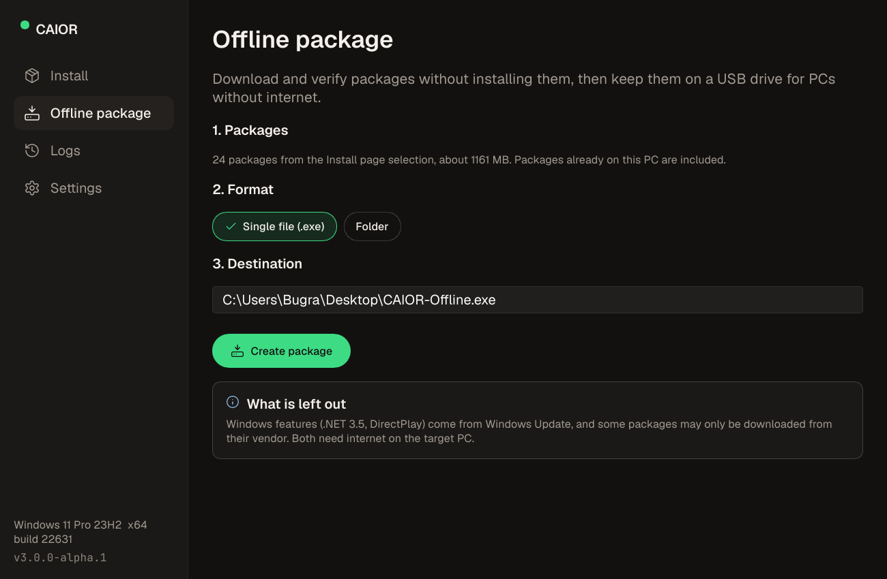

# CAIOR - croxz all-in-one runtimes

One small Windows app that sets up every common runtime after a fresh install: Visual C++ 2005 to v14, .NET Framework and .NET 6-10, DirectX, WebView2, Windows App Runtime, WinGet, Java, XNA, OpenAL, PhysX and more. Silent, one administrator prompt, and it also works offline.


- **Install** - pick a profile (Recommended, Gaming, Developer, Legacy, Everything) or single packages. CAIOR checks what this PC already has, downloads only what is missing from the vendor's own servers, verifies every file, and installs it silently.
- **Offline package** - downloads and verifies without installing, then writes one portable `.exe` (or a folder) with everything inside. Run it on a PC without internet after a format and it installs from the bundle.
- **Follow along or forget it** - minimize the window and a small card in the bottom-right corner keeps showing progress until it is done.

| Installing (Turkish UI, light theme) | Progress card | Offline package |
| --- | --- | --- |
|  |  |  |

> Status: alpha (3.0.0-alpha.1). Tested on Windows 11 in Windows Sandbox: the Recommended and Gaming profiles install cleanly online and from an offline package with networking turned off.

## Download

Get `caior.exe` from [Releases](../../releases). It is a single file (about 13 MB) with no dependencies; it runs on a fresh Windows 10 1809+ or Windows 11, x64.

The exe is not code-signed yet, so Windows SmartScreen may warn the first time. Check the SHA256 next to the download if you want to be sure it is the file the CI built.

## Using it

Double-click `caior.exe`. Choose packages, then **Install**. Windows asks for administrator approval once.

From a terminal:

```
caior detect                                    # what is installed on this PC
caior install --profile recommended --silent    # install without questions
caior install --profile gaming --id dotnet-desktop-6-* --exclude vc-2005-* -y
caior pack --profile recommended --out D:\CAIOR-Offline.exe
caior pack --profile all --folder --out E:\caior
caior list                                      # every package id
```

Exit codes: `0` done, `3010` done and Windows needs a restart, `1` something failed, `1223` administrator approval declined. Logs are in `%ProgramData%\CAIOR\logs`, one folder per run with a log per package.

The exe is a GUI program, so `cmd` does not wait for it; use `start /wait caior.exe install ...` (or `Start-Process -Wait` in PowerShell) in scripts.

## How it stays safe

- Every download comes from the vendor (Microsoft, Eclipse Adoptium, NVIDIA, Creative, LunarG, python.org, nodejs.org). Nothing is mirrored or re-hosted by this project.
- Pinned installers must match their SHA256; "latest" links must carry a valid Authenticode signature from an allowed publisher. Signatures are checked offline, so offline packages are verified the same way.
- Right before it runs, each installer is locked against changes and verified again: the file that was checked is the file that runs.
- The elevated part only accepts package ids and rebuilds the plan from the catalog built into the exe.
- Installers run with a timeout inside a job object; a busy Windows Installer (1618) is retried. A wrapper that reports success while the product is still missing counts as a failure.

## Packages

The catalog lives in [`catalog/`](catalog), one TOML file per category, each entry with its official URL, silent switches, detection rule, and hash or signer. See [docs/CATALOG-FORMAT.md](docs/CATALOG-FORMAT.md) and [docs/PACKAGES.md](docs/PACKAGES.md).

Known limits:

- .NET Framework 3.5, DirectPlay and the Media Feature Pack are Windows features; they come from Windows Update and need internet on the target PC.
- Windows Sandbox cannot install side-by-side assemblies or Windows features, so VC++ 2005/2008 and those features were tested only for silent switches, not end to end.
- Offline packages contain the packages for the architecture of the PC that built them.

## Building

Requirements: Windows, Rust 1.88+ (MSVC toolchain).

```
cargo build --release -p caior          # target\release\caior.exe
cargo test --workspace
cargo xtask catalog check --strict      # validate the catalog
cargo xtask catalog probe               # do all URLs answer
cargo xtask catalog refresh --file vcredist.toml   # download, hash, read signatures
```

Real installs are tested only in Windows Sandbox: [tools/sandbox](tools/sandbox).

## Repository layout

| Path | What |
| --- | --- |
| `crates/core` | Engine: catalog, detection, download and verification, install runners, offline packages |
| `crates/app` | `caior.exe`: GUI (Slint), CLI and the elevated worker |
| `catalog/` | Package catalog |
| `ui/`, `i18n/` | UI (Bugra design system), fonts, icons, Turkish translation |
| `xtask/` | Developer tools for the catalog |
| `tools/sandbox/` | Windows Sandbox test harness |
| `docs/` | Plan, catalog format, packages, UI design (Turkish) |
| `design/bugra/` | Design tokens the UI theme is generated from |
| `legacy/` | Earlier versions (PowerShell tray installer, Tauri app), kept for reference |

## License

MIT, see [LICENSE](LICENSE). Installers are not part of this repository; each runtime keeps its vendor's license.

Built with [Slint](https://slint.dev) (royalty-free license). Fonts: Geist and JetBrains Mono (SIL OFL 1.1). Icons: Lucide (ISC).
